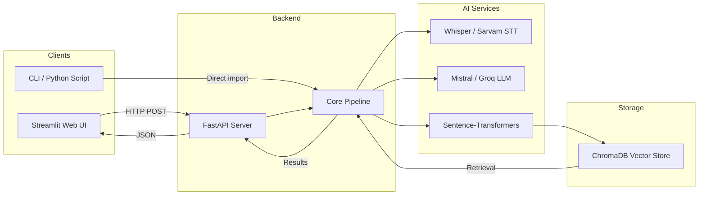
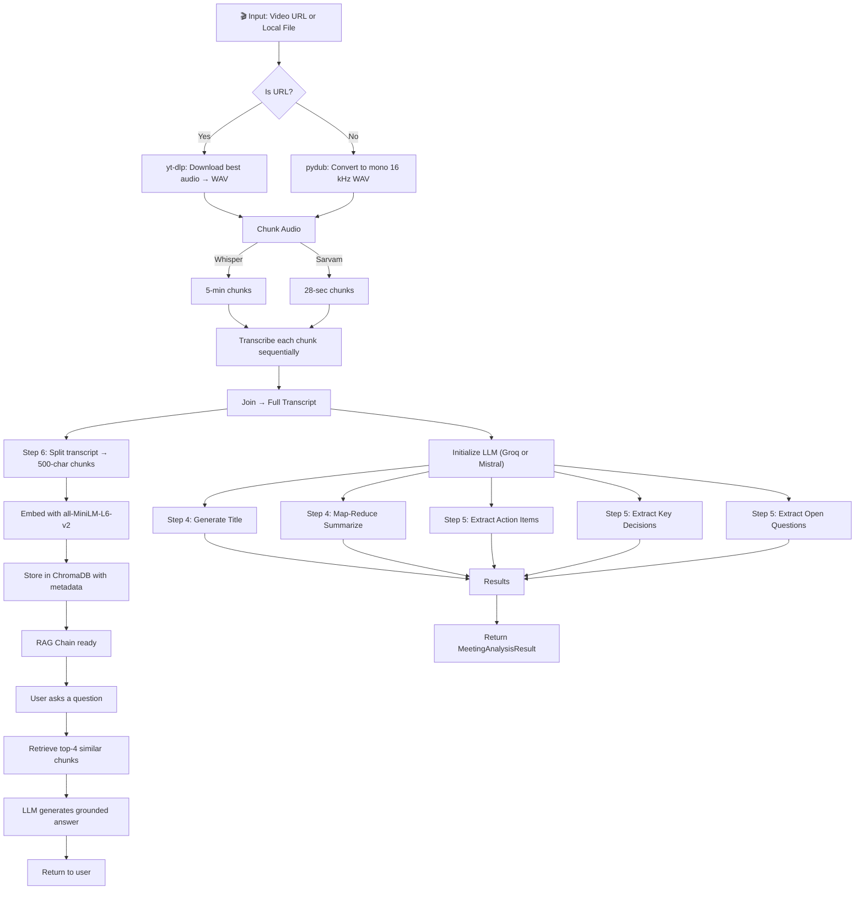

<p align="center">
  <h1 align="center">🎬 AI Video Assistant</h1>
  <p align="center">
    Turn any video or audio into a searchable transcript, meeting summary, action items, key decisions, open questions — and then <strong>chat</strong> with your content using RAG-powered Q&A.
  </p>
</p>

---

## 📑 Table of Contents

- [Overview](#overview)
- [Tech Stack](#-tech-stack)
- [Project Structure](#-project-structure)
- [Architecture & Workflow](#-architecture--workflow)
- [How It Works — Step by Step](#-how-it-works--step-by-step)
- [Module Deep Dive](#-module-deep-dive)
- [API Reference](#-api-reference)
- [Setup & Installation](#-setup--installation)
- [Running the Application](#-running-the-application)
- [Environment Variables](#-environment-variables)
- [Testing](#-testing)

---

## Overview

AI Video Assistant is an end-to-end Python application that accepts a video URL (YouTube or any yt-dlp-supported site) or a local audio/video file, processes it through a multi-stage AI pipeline, and produces:

- **Full transcript** — via OpenAI Whisper (local) or Sarvam cloud STT
- **Professional meeting title** — auto-generated from the transcript
- **Concise summary** — using a map-reduce summarization strategy
- **Action items** — with task, owner, and deadline extraction
- **Key decisions** — all confirmed decisions from the meeting
- **Open questions** — unresolved topics needing follow-up
- **RAG-powered Q&A** — ask free-form questions about the content and get grounded answers from a ChromaDB vector index

The project ships with three interfaces: a **Streamlit web UI**, a **FastAPI REST API**, and a **CLI**.

---

## 🛠 Tech Stack

| Layer | Technology |
|-------|-----------|
| **Language** | Python 3.10+ |
| **Web UI** | Streamlit (custom CSS, dark mode, components) |
| **REST API** | FastAPI + Uvicorn |
| **HTTP Client** | httpx, requests |
| **Media Download** | yt-dlp (YouTube, Vimeo, 1000+ sites) |
| **Audio Processing** | pydub (chunking, format conversion, mono/16 kHz) |
| **Speech-to-Text** | OpenAI Whisper (local, GPU/CPU) · Sarvam AI (cloud API) |
| **LLM Providers** | Mistral AI (`langchain-mistralai`) · Groq (`langchain-groq`) · OpenAI-compatible |
| **LLM Orchestration** | LangChain (core, community, text-splitters, LCEL chains) |
| **Embeddings** | Sentence-Transformers (`all-MiniLM-L6-v2`) via HuggingFace |
| **Vector Store** | ChromaDB (persistent SQLite-backed) |
| **Database** | SQLite + SQLAlchemy 2.x (persistent analysis history) |
| **Data Validation** | Pydantic v2 (request/response schemas with field validators) |
| **PDF Export** | ReportLab |
| **Testing** | pytest, unittest |
| **Environment** | python-dotenv |

---

## 📁 Project Structure

```
AI Video Assistant/
│
├── api/                        # FastAPI application
│   ├── app.py                  # App factory, exception handlers, router registration
│   ├── deps.py                 # Shared dependencies (cached LLM, in-memory RAG sessions)
│   └── routes/
│       ├── health.py           # GET  /api/v1/health
│       ├── pipeline.py         # POST /api/v1/pipeline         (full pipeline)
│       ├── transcription.py    # POST /api/v1/transcribe        (transcribe only)
│       ├── analysis.py         # POST /api/v1/summarize|title|extract/*
│       └── rag.py              # POST /api/v1/rag/index|query
│
├── core/                       # Pipeline stages (the "engine")
│   ├── audio_processor.py      # Download, convert to WAV, chunk audio
│   ├── transcriber.py          # Whisper & Sarvam STT integration
│   ├── summarizer.py           # Map-reduce summarization + title generation
│   ├── extractor.py            # Action items, decisions, questions extraction
│   ├── rag_engine.py           # RAG chain: build, load, query
│   └── vector_store.py         # ChromaDB: build, load, retriever factory
│
├── frontend/                   # Streamlit web interface
│   ├── main.py                 # App entry point, page routing, session state
│   ├── api_client.py           # HTTP client for the FastAPI backend
│   └── ui/
│       ├── components.py       # Reusable HTML/Streamlit components
│       ├── styles.py           # CSS loader (light + dark mode)
│       └── styles.css          # Full custom stylesheet
│
├── schemas/                    # Pydantic models
│   ├── audio.py                # AudioProcessRequest, TranscribeRequest
│   ├── analysis.py             # SummarizeRequest, MeetingAnalysisResult
│   ├── pipeline.py             # PipelineInput
│   ├── rag.py                  # IndexTranscriptRequest, QueryRequest
│   └── responses.py            # API response models
│
├── utils/
│   └── llm.py                  # LLM factory (Groq → Mistral → error)
│
├── tests/
│   └── test_api.py             # Offline API tests
│
├── cli.py                      # Standalone CLI entry point
├── requirements.txt            # Python dependencies
├── .env                        # Environment variables (not committed)
└── vector_db/                  # ChromaDB persistent storage (auto-created)
```

---

## 🏗 Architecture & Workflow

### High-Level System Architecture



### Detailed Pipeline Flow



---

## 🔍 How It Works — Step by Step

### Step 1 — Audio Processing (`core/audio_processor.py`)

The pipeline begins by obtaining clean audio:

1. **URL input**: `yt-dlp` downloads the best available audio stream and converts it to WAV using FFmpeg.
2. **Local file input**: `pydub` converts any supported format (mp4, mkv, mp3, flac, etc.) to mono 16 kHz WAV — the optimal format for speech recognition.
3. **Chunking**: The WAV file is split into sequential chunks:
   - **Whisper engine** → 5-minute chunks (300 seconds) — Whisper handles longer segments well.
   - **Sarvam engine** → 28-second chunks — required by the Sarvam cloud API's input limits.

### Step 2 — Transcription (`core/transcriber.py`)

Each audio chunk is routed to the selected STT engine:

- **Whisper** (local): Loads the model once (singleton pattern), then transcribes each chunk using `model.transcribe()`. Runs entirely on your machine (CPU or GPU).
- **Sarvam** (cloud): Sends each chunk as a WAV file to the Sarvam `speech-to-text-translate` API endpoint, which also handles translation to English for multilingual content.

All chunk transcripts are joined into a single continuous string.

### Step 3 — LLM Initialization (`utils/llm.py`)

The LLM factory checks environment variables in priority order:
1. `GROQ_API_KEY` → instantiates `ChatGroq` (default model: `openai/gpt-oss-120b`)
2. `MISTRAL_API_KEY` → instantiates `ChatMistralAI` (default model: `mistral-large-latest`)
3. Neither set → raises `ValueError`

The LLM instance is cached as a singleton across API requests.

### Step 4 — Summarization & Title (`core/summarizer.py`)

Uses a **map-reduce** strategy for handling long transcripts:

1. **Split**: `RecursiveCharacterTextSplitter` breaks the transcript into 3,000-character chunks with 200-character overlap.
2. **Map**: Each chunk is independently summarized by the LLM, preserving key discussions, decisions, action items, owners, deadlines, and numbers.
3. **Reduce**: All partial summaries are combined into one final professional meeting summary with appropriate headings, bullet points, and no repetition.
4. **Title**: The first 2,000 characters of the transcript are sent to the LLM to generate a concise ≤ 8-word meeting title.

### Step 5 — Information Extraction (`core/extractor.py`)

Three independent LangChain chains extract structured insights:

| Extraction | What It Finds |
|------------|---------------|
| **Action Items** | Task description, owner, deadline (or "Not specified") |
| **Key Decisions** | All confirmed decisions, formatted as a numbered list |
| **Open Questions** | Unresolved topics needing follow-up |

Each chain uses a `ChatPromptTemplate` with a specialized system prompt → LLM → `StrOutputParser`.

### Step 6 — RAG Indexing (`core/vector_store.py` + `core/rag_engine.py`)

The transcript is indexed for later Q&A:

1. **Split**: `RecursiveCharacterTextSplitter` creates 500-character chunks with 50-character overlap.
2. **Embed**: Each chunk is embedded using `all-MiniLM-L6-v2` (a fast, CPU-friendly sentence transformer).
3. **Store**: Chunks are upserted into ChromaDB with metadata (`video_id`, `video_title`, `session_id`, `chunk_index`). Deterministic IDs ensure re-indexing replaces old chunks cleanly.
4. **Retrieve**: A filtered retriever fetches the top-4 most similar chunks, optionally filtered by `session_id` and `video_id`.
5. **Answer**: An LCEL chain pipes context + question through the LLM with strict grounding rules — the LLM must only use supplied context and never invent facts.

---

## 📦 Module Deep Dive

### Frontend (`frontend/`)

The Streamlit UI provides a polished, multi-page experience:

- **Dashboard**: Hero section, source input (URL or file upload), engine selector, analysis results display (summary, action items, decisions, questions, transcript), processing timeline, and a chat panel for RAG Q&A.
- **History**: Fetches saved analyses from SQLite via FastAPI (`/api/v1/history`), with Open Analysis (restores Dashboard without rerunning the pipeline) and Delete actions.
- **Settings**: Default engine selection.
- **About**: Project description.
- **Dark mode**: Toggle in the sidebar applies a full dark theme via CSS injection.

The frontend communicates with the FastAPI backend via `api_client.py`, which wraps HTTP calls.

### API & Persistence (`backend/api/` + `backend/db/`)

FastAPI provides versioned endpoints under `/api/v1`:

- Global exception handlers for `ValidationError` (422) and `ValueError` (400).
- **SQLite Persistence (`backend/db/`)**: SQLAlchemy ORM (`AnalysisHistory` table) stored at `backend/data/history.db` (auto-initialized on startup). Successful `/api/v1/pipeline` runs are automatically saved; failed runs are not persisted.
- **RAG Persistence**: `rag_sessions` caches active RAG chains in memory and lazily reconstructs chains from persistent ChromaDB (`backend/vector_db/`) after server restarts without unnecessary re-embedding.
- LLM is cached as a singleton via `@lru_cache`.

### Schemas (`schemas/`)

All inputs are validated with Pydantic v2 field validators:
- Sources must be a URL or end with a supported media extension.
- Transcripts must contain ≥ 3 words.
- Questions must be ≥ 2 characters.
- Engine is normalized to lowercase.

---

## 📡 API Reference

| Method | Endpoint | Description |
|--------|----------|-------------|
| `GET` | `/api/v1/health` | Health check (status + version) |
| `POST` | `/api/v1/pipeline` | Full pipeline: audio → transcript → analysis → RAG index |
| `POST` | `/api/v1/transcribe` | Transcribe audio only |
| `POST` | `/api/v1/summarize` | Summarize a transcript |
| `POST` | `/api/v1/title` | Generate a meeting title |
| `POST` | `/api/v1/extract/action-items` | Extract action items |
| `POST` | `/api/v1/extract/decisions` | Extract key decisions |
| `POST` | `/api/v1/extract/questions` | Extract open questions |
| `POST` | `/api/v1/rag/index` | Index a transcript for RAG |
| `POST` | `/api/v1/rag/query` | Query an indexed transcript (auto-restores from ChromaDB after restart) |
| `POST` | `/api/v1/history` | Save a completed analysis to SQLite |
| `GET` | `/api/v1/history` | List saved analyses (newest first) |
| `GET` | `/api/v1/history/{id}` | Retrieve complete saved analysis by ID |
| `DELETE` | `/api/v1/history/{id}` | Delete a saved analysis by ID |

Interactive docs available at `http://localhost:8000/docs` (Swagger) and `/redoc`.

---

## ⚙ Setup & Installation

```powershell
# 1. Clone the repository
git clone <repo-url>
cd "AI Video Assistant"

# 2. Create and activate a virtual environment
python -m venv .venv
.\.venv\Scripts\activate

# 3. Install all dependencies
pip install -r requirements.txt
```

> **Note**: Whisper requires `ffmpeg` on your system PATH for audio conversion.

---

## ▶ Running the Application

### 1. Start the API server (required for the web UI)

```powershell
uvicorn api.app:app --app-dir backend --reload --port 8000
```

### 2. Launch the Streamlit web UI

```powershell
streamlit run frontend/main.py
```

### 3. Use the CLI directly

```powershell
python backend/cli.py
```

You will be prompted for a video URL or file path and your choice of transcription engine.

---

## 🔑 Environment Variables

Create a `.env` file in the project root:

```env
# LLM Provider (at least one required)
GROQ_API_KEY=your-groq-key              # Priority 1
GROQ_MODEL=openai/gpt-oss-120b          # Optional, default shown
MISTRAL_API_KEY=your-mistral-key         # Priority 2 (fallback)
MISTRAL_MODEL=mistral-large-latest       # Optional, default shown

# Speech-to-Text
WHISPER_MODEL=small                      # Whisper model size: tiny, base, small, medium, large
SARVAM_API_KEY=your-sarvam-key           # Required only for engine="sarvam"
SARVAM_STT_MODEL=saaras:v2.5            # Sarvam model version

# Processing
TRANSCRIPTION_WORKERS=2                  # Parallel transcription workers

# Storage (optional overrides)
DOWNLOAD_DIR=downloads                   # Where yt-dlp saves media
CHROMA_PERSIST_DIR=backend/vector_db     # ChromaDB persist directory
HISTORY_DB_PATH=backend/data/history.db  # SQLite analysis history database
# DATABASE_URL=sqlite:///...             # Optional full SQLAlchemy URL override
```

---

## 🧪 Testing

Run the offline test suite (no external API calls):

```powershell
.\.venv\Scripts\python.exe -m unittest discover -s tests -v
```

Or with pytest:

```powershell
pytest tests/ -v
```

---

<p align="center"><em>Built with ❤️ by Anubhav</em></p>
